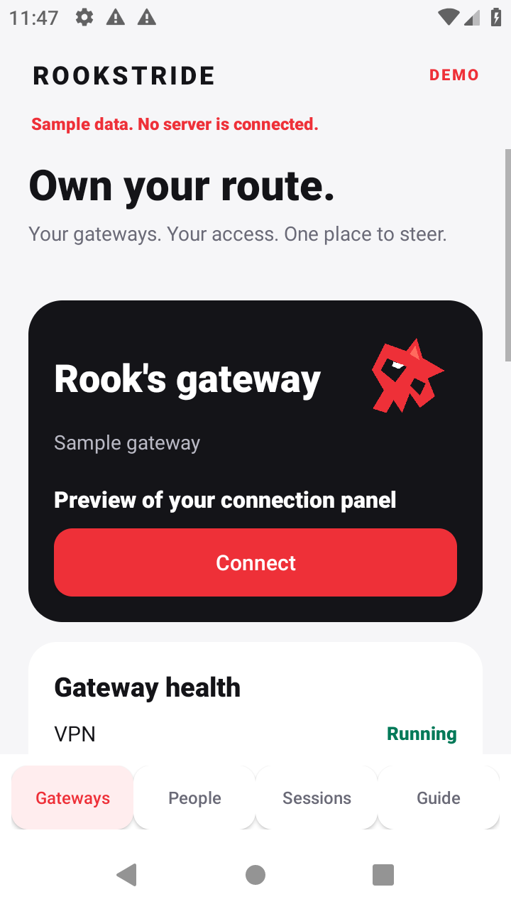
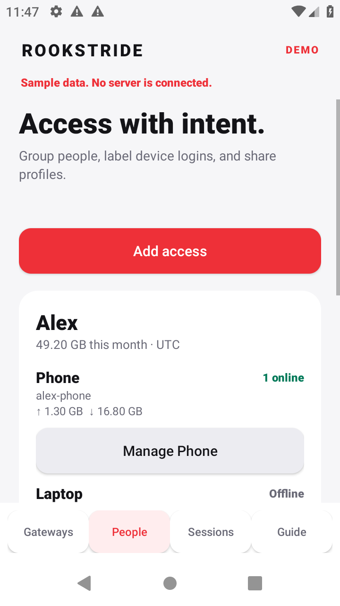
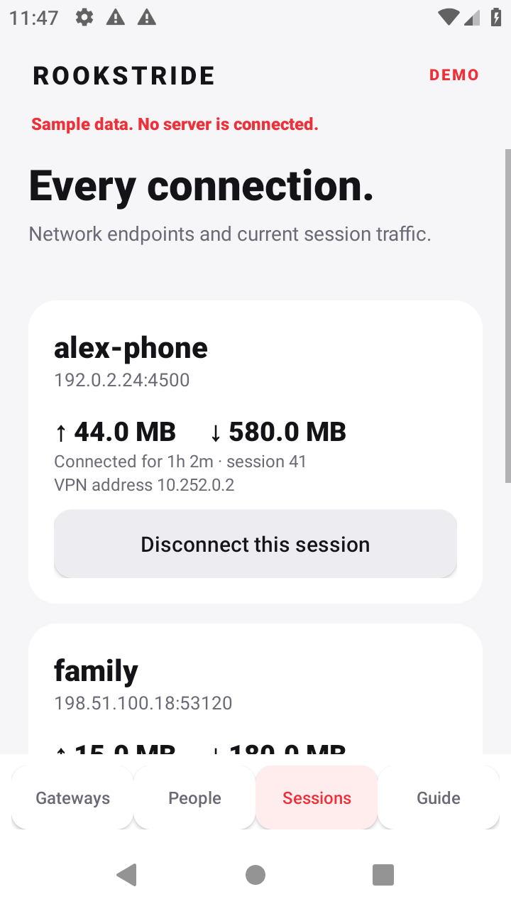
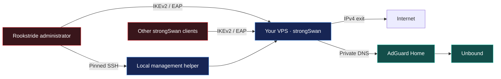
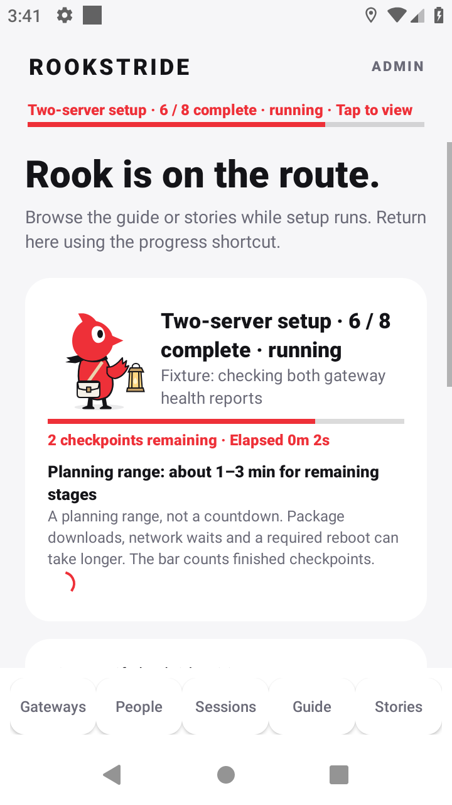
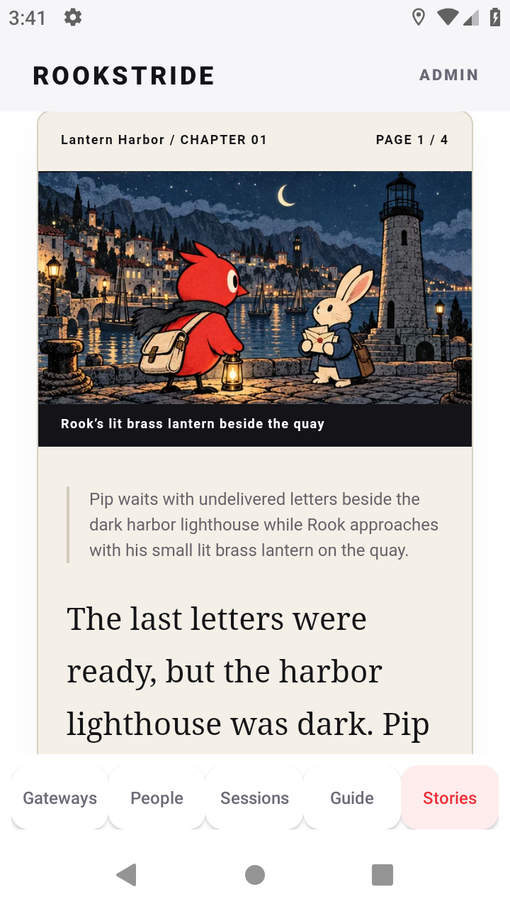
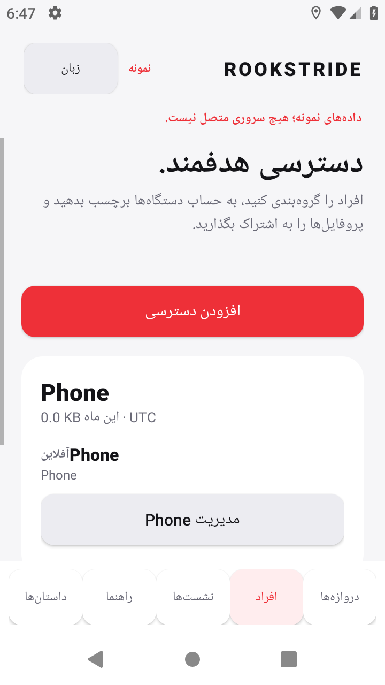
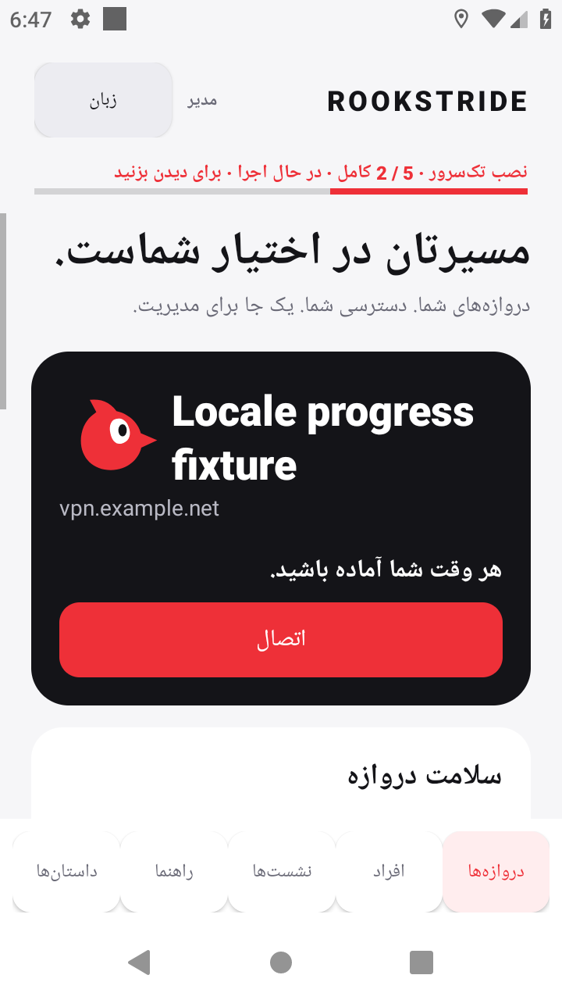

  

<h1 align="center">Rookstride</h1>

  Deploy your VPN. Share access. Keep moving. 
  An open-source VPN manager for Ubuntu servers you rent.

  
  
  
  
  
  
  

  <a href="#quick-start">Quick start</a> ·
  <a href="docs/OPERATIONS.md">App guide</a> ·
  <a href="docs/ARCHITECTURE.md">Architecture</a> ·
  <a href="docs/UNIVERSAL-GATEWAY-RESEARCH.md">Future routes</a> ·
  <a href="#vpn-and-filtering-behavior">Ad blocking</a> ·
  <a href="docs/TESTING.md">Tests</a> ·
  <a href="docs/BUILD.md">Build</a> ·
  <a href="SECURITY.md">Security</a>

Rookstride sets up and manages a VPN on your own Ubuntu VPS. The Android app
includes ten connection methods, account management and experimental Double VPN.
See the [device guide](https://rookstride.com/connect) for supported clients and
profile formats. The [website](https://rookstride.com) also offers a browser demo,
an invitation-only VPN workspace and [assistant setup](https://rookstride.com/agents).

**Android 0.4.0-alpha6.** Download the [signed universal APK](https://github.com/VictorBoykoV/rookstride/releases/download/v0.4.0-alpha6/rookstride-0.4.0-alpha6-universal.apk).
The [release includes checksums, ARM64 and corresponding source](https://github.com/VictorBoykoV/rookstride/releases/tag/v0.4.0-alpha6).
The app requires Android 8 or later. Check [Ubuntu compatibility](docs/UBUNTU-COMPATIBILITY.md)
for your chosen method and [test status](docs/TESTING.md) for the evidence available.

> [!IMPORTANT]
> **Earlier 0.1.0-alpha2 passed three consecutive reset → reinstall → real VPN cycles** on Android 8, 9 and 16, including recovery after a VPS reboot. Physical-device, network-handoff and sustained-load checks remain. The [test report](docs/TESTING.md) records the exact scope and the two regression fixes.

## Server administration and recovery

The 0.4 prerelease includes a management interface,
reviewed SSH identity replacement, scoped administrator invitations, owner
recovery, coordinated paired rebuilds and AWG pair member replacement. See
[maintenance and recovery](docs/MAINTENANCE-AND-RECOVERY.md) for the exact supported
adapters and retained-data boundaries.

The app can manage servers with a VPN off or with another VPN client
active, subject to that client's Android routing/lockdown rules. Double VPN
checks direct SSH access and can automatically use the reachable node as a
verified relay. Manually chosen VPN passwords use advisory strength warnings;
generated passwords remain15 random characters.

**Wipe server & reinstall Ubuntu** is separate from **Remove VPN setups** and
**Remove server from this phone**. Eligible full virtual machines can replace
their system disk with a reviewed Ubuntu22.04/24.04/26.04 image. The app verifies
the planned replacement SSH identity and the returned OS before completion.
Unsupported layouts still need provider rebuild tools. Future Ubuntu eligibility
varies by provider and disk layout. See [server management](docs/SERVER-MANAGEMENT.md).

## Reusable sign-in

The app offers address, username and password sign-in for
IKEv2, OpenVPN, Hysteria 2, TrustTunnel and NaïveProxy, including supported
Double VPN entries. New app installations prefer this mode; existing private
profiles keep their explicit migration boundary. See [reusable sign-in](docs/REUSABLE-SIGN-IN.md)
for server trust, IP/domain setup, sharing, reinstall continuity and limitations.

## Connection methods

The app includes AmneziaWG 3.1, IKEv2, OpenVPN and VLESS TCP/REALITY as well as
**VLESS XHTTP/REALITY, Hysteria 2, Outline/WSS, Shadowsocks/v2ray-plugin WSS,
TrustTunnel HTTP/2 and NaïveProxy HTTP/2.** Single-server and Double VPN setup
use the phone's pinned SSH connection. No extra client app is required.

See the [connection comparison](docs/CONNECTION-METHODS.md),
[acceptance report](docs/ADDITIONAL-METHODS-TESTING.md) and
[embedded-engine contract](docs/EMBEDDED-ENGINES.md). Ad blocking, operational
traffic estimates, user management, profile sharing and managed removal apply
to the new methods. Setup normally asks for the server address and administrator
password, with `root` as the default administrator. This development edition is
English; the earlier translation catalogs remain retained.

## What it does

| Capability | In the app |
|---|---|
| Two servers | Experimental Double VPN with a separate entry and exit, exit-side DNS and staged activation. |
| Deploy | Install a selected protocol and filtering over pinned SSH. |
| Connect | Use the app's embedded clients on Android. |
| Share | Export a compatible profile or reusable sign-in, depending on the method. |
| Manage access | Organize gateways, people, shared accounts and separate device logins. |
| See connections | Inspect sessions, observed endpoints, VPN addresses and counters; disconnect or revoke access. |
| Track usage | Optionally collect daily and monthly estimates with a small local SQLite service. |
| Filter DNS | Choose Standard, Strong or Strict ad and tracker blocking. |
| Start again | Review and reset a recognized gateway with typed deletion confirmation. |
| Follow installation | Recipe-specific checkpoints, elapsed time, remaining steps and coarse planning ranges; browse while the service continues. |
| Languages | English, Русский, فارسی, العربية, 简体中文; follows a supported phone language, with an in-app selector and English fallback. |
| Learn offline | Built-in guide, licenses, five story worlds and fifty chapters with optional installed-device narration. |

No cloud account or public web management API is involved. Root access belongs to the administrator; it is never included in user profiles.

Screenshots show the explicitly labeled, offline demo with fictional data. Meet **Rook**, the original red bird mark used in the app and launcher.

## Quick start

1. Install the APK from a release whose checksum and signing certificate you have verified. Android may ask you to allow installation from your download app.
2. Choose **Add gateway**. Enter the VPS address, SSH port, administrator name and password or private key. Root or passwordless sudo is required.
3. Inspect the gateway. Compare the presented SSH fingerprint with your provider console before trusting it. A changed fingerprint stops the connection.
4. On a fresh Ubuntu 24.04 VPS, choose **Install gateway on fresh VPS**, create the first VPN login, and decide whether to enable usage history.
5. Follow the progress view, or browse Guide and Stories while setup continues. The progress shortcut and notification return to the current stage. Detached server jobs can continue after phone polling ends; inspect and resume the recorded job.
6. In **People**, select a login and choose **Use on this phone**, then connect from the gateway screen. Or share a user's profile and provide their VPN password separately.

After connecting, verify website access, the exit IPv4, DNS filtering and absence of an unexpected public IPv6 from the actual device over both Wi-Fi and mobile data. See [app operations](docs/OPERATIONS.md).

Use a disposable VPS to try the alpha. An interrupted installation can leave partial configuration; inspect its root-only log before deciding to rebuild. The fresh-install guard deliberately refuses to overwrite an existing VPN or DNS setup.

Existing installations of the bundled [single VPS gateway](https://github.com/VictorBoykoV/single-vps-vpn-gateway) can explicitly enroll the management helper. Arbitrary StrongSwan installations need a migration review; they are not automatically compatible.

## How it works

## VPN and filtering behavior

The Android profile uses MTU 1280, full IPv4 and IPv6 traffic selectors, and blocks traffic outside the VPN while the tunnel is active. This gateway provides IPv4 Internet access and sinks IPv6; AdGuard suppresses AAAA answers. The strongSwan engine exempts Rookstride’s own administration/certificate-fetch traffic so management remains reachable; other applications use the VPN. Android's **Always-on VPN / Block connections without VPN** setting is a separate phone setting for protection while disconnected.

DNS blocking can remove ads and trackers served from separate domains. It cannot reliably remove YouTube in-stream ads, change a datacenter IP's reputation, or stop a site using account, browser or GPS signals. Applications with their own encrypted DNS may bypass DNS filtering. Stronger lists can also break websites; return to Standard or allow a required domain in the private AdGuard dashboard.

Open **Gateways → AdGuard controls** to choose a preset:

| Preset | List | Tradeoff |
|---|---|---|
| Standard | AdGuard DNS filter | Starting point for ordinary ads and trackers. |
| Strong | HaGeZi Pro | Broader blocking; compare website access afterward. |
| Strict | HaGeZi Pro++ | Most aggressive preset; more likely to block a required domain. |

The private dashboard is `http://10.254.0.1:3000` by default, reachable inside the VPN. Its separate login is stored in `/root/single-vps-vpn/adguard-login.txt` on the VPS. See [app operations](docs/OPERATIONS.md) for access, allowlists and recovery.

## People, devices and totals

A shared login can have several simultaneous connections. Separate device credentials give each profile its own login and make revocation and totals clearer. Device labels are administrator supplied; IPsec does not reveal a phone's physical model or router hostname.

Disconnect closes the selected session; a client may automatically reconnect. Revoke removes the login and attempts to close all its sessions, preventing new authentication with that login.

The optional collector samples every 30 seconds and consumes disconnect/rekey events. Totals are UTC calendar-month estimates, excluding IPsec transport overhead. They begin at enrollment, survive collector restarts, and expose monitoring gaps. They are not billing records. See [architecture and resource limits](docs/ARCHITECTURE.md).

## Build, test and contribute

- [App operations and safe reset](docs/OPERATIONS.md)
- [Build the APK and corresponding source](docs/BUILD.md)
- [Testing and release gates](docs/TESTING.md)
- [Architecture](docs/ARCHITECTURE.md)
- [Security and recovery](SECURITY.md)
- [Third-party licenses](NOTICE.md)

The original Android administration code and branding are GPL-3.0-or-later. The embedded strongSwan code retains its upstream GPL-2.0-or-later notices; the combined app is distributed under GPL version 3 or later. Gateway scripts retain their MIT license. No affiliation with strongSwan, AdGuard, OnePlus or Amnezia is implied.

## Two-server gateway – experimental

Use the [Android pair guide](docs/PAIR-MODE.md) or the standalone
[two-server Ubuntu scripts](https://github.com/VictorBoykoV/two-hop-vpn-gateway).

The earlier provider-tested `0.2.0-alpha2` recipe is: **IKEv2 entry → AmneziaWG 3.1 exit** with independently pinned SSH, detached recoverable jobs, exit-side AdGuard Home and staged activation. Choose **Add a two-server gateway** in the experimental app. Reviewed **Reset both VPN nodes** and **Swap entry and exit** controls allow fresh redeployment from the phone. An optional native SSH relay manages one node through the other while retaining both physical-node identity pins.

The Android setup offers ten methods on each leg. Use dedicated test servers
and check the evidence for the route you choose. [Route contracts and test scope](docs/PAIR-MODE.md)

Read the [pair guide](docs/PAIR-MODE.md), [real-provider test report](docs/PAIR-PROVIDER-TESTING.md) and [historical local alpha1 tests](docs/PAIR-TESTING.md). The same signed 0.2.0-alpha2 APK configured both real-provider nodes repeatedly, with clean phone resets and reversed roles. Embedded Android and isolated provider-side Linux clients verified IKE/EAP, exit IPv4, filtering and bridge-outage blocking/recovery. The report identifies each client network: one route from the test computer lost UDP replies, while its provider-side client passed. Android 16's coordinator/VPN passed; its emulator's screen navigation remains incomplete because of System UI startup hangs.

The earlier `0.1.0-alpha2` binary is the single-server release. Pair upgrades/importing arbitrary installations and unimplemented route combinations in the [research note](docs/UNIVERSAL-GATEWAY-RESEARCH.md) remain future work. Reset removes owned gateway data and retains Ubuntu, SSH, packages and unrelated files; whole-OS replacement is a separate reviewed action on eligible VMs, with provider rebuild tools for unsupported layouts.

## Rook, your guide

Rook is the project’s original ambassador: a small red navigator who steps out of a
book, listens before helping, and leaves room for the next traveler’s choice.
His map, lantern, scarf, and satchel follow him through five connected fictional
worlds. The revised mark keeps a simple, recognizable bird silhouette.

**Five worlds · fifty finished chapters · two hundred story pages.** Lantern Harbor
leads into worlds inspired by Persian gardens, Chinese waterways, Russian winter
stories, and American civic communities. Read one illustrated page or the whole
chapter; optional device narration highlights the scene and turns pages within
that chapter. The next chapter waits for your choice. The original five strip comics
remain available. Culture notes distinguish source inspiration from original fiction.

- [Rook’s origin, character, and ambassador roles](brand/AMBASSADOR.md)
- [The fifty-chapter index and cast](website/WORLDS.md)
- [Artwork and original master sources](website/ARTWORK-WORLDS.md)
- [Build or host the portable website](website/README.md)
- [Installation progress and offline reading](docs/INSTALLATION-PROGRESS.md)

The mobile coordinator shows each recipe’s checkpoints and broad planning ranges.
Stories and Guide stay available while installation runs in a separate foreground
service. Tap the progress shortcut or notification to return. Force-stop or process
death may end phone polling; detached VPS jobs can continue and require inspection
before resuming. Text, art, and documentation are bundled for offline reading.

[Mark revision notes](brand/DESIGN.md) and [brand rules](brand/AMBASSADOR.md) preserve
Rook’s identity across code, app, website, and community artwork. The website remains
a local portable build; publishing GitHub source is separate from public website hosting.

## Current app and historical server evidence

The signed **0.2.0-alpha4** language edition adds five interface catalogs, native
language selection and translated offline beginner guides. Its [localization test
scope](docs/LOCALIZATION-TESTING.md) separates resource/UI checks from actual
provider deployments. The earlier [alpha3 UI report](docs/UI-ALPHA3-TESTING.md)
retains its own signed APK identity for progress and story tests.
The server installer bundle is unchanged from 0.2.0-alpha2. The four independent
provider-pair runs in [the earlier report](docs/PAIR-PROVIDER-TESTING.md) tested that
exact earlier APK; they are not new alpha4 deployment claims.

Exact signed alpha3 screens on Android 9. Progress is an explicitly labeled
transport fixture; the story is a real bundled page. Narration tests use
deterministic voice events rather than an audible voice performance.

## Languages and future platforms

The current Android setup and management interface is in English. The source
retains the earlier English, Russian, Persian, Arabic and Simplified Chinese
translation catalogs. Technical inputs and typed confirmations are unchanged
within a translation.

The local website includes translated home, setup, architecture, routes, download, open source, Rook, worlds overview and plans pages. Distinct URLs and an explicit language menu avoid forced language redirects. The fifty stories, images and detailed engineering documents remain English and are labeled accordingly.

[Translation workflow](i18n/README.md) · [Platform and language research](docs/PLATFORMS-AND-LANGUAGES.md) · [Localization test scope](docs/LOCALIZATION-TESTING.md)

The [browser workspace and local operator connector](web/README.md) provide
additional setup and management routes. The [public assistant endpoint](https://rookstride.com/mcp)
offers read-only examples. The invitation-only workspace has a separate origin
for approved gateway administration.

Signed alpha4 screens on Android 9. English names and logins in the fixture retain their original spelling. These images show UI tests, not a new server deployment.

## Private development edition: embedded protocol connections

The 0.3.0-alpha2 candidate adds in-app single-server connections for AmneziaWG
3.1, Xray/VLESS/REALITY and OpenVPN alongside IKEv2. Setup/import/manage tasks
are English-only in this edition. Select a saved VPN and tap Connect; additional
VPN applications are not required. [Single-server choices](docs/SINGLE-PROTOCOLS.md),
[engine architecture](docs/EMBEDDED-ENGINES.md) and [build instructions](docs/BUILD.md)
describe supported formats and capability boundaries. The public alpha4 links
above retain their historical release identity.
