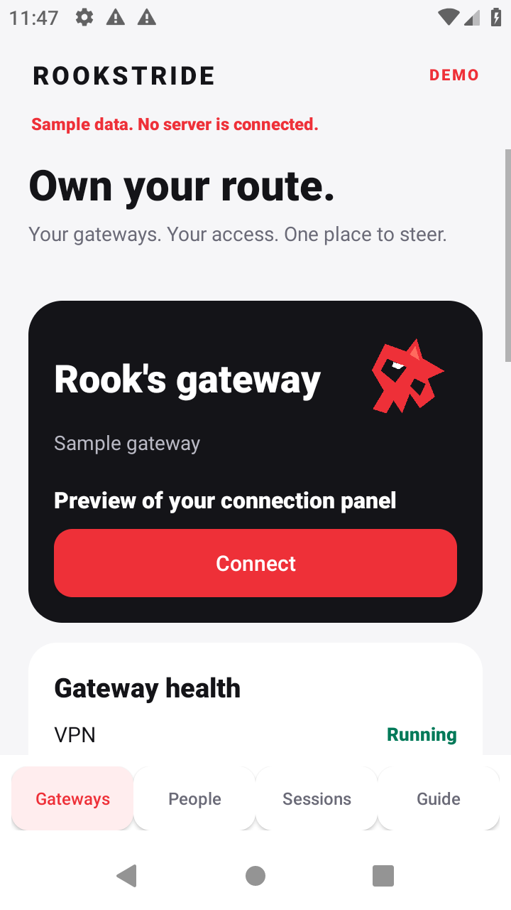
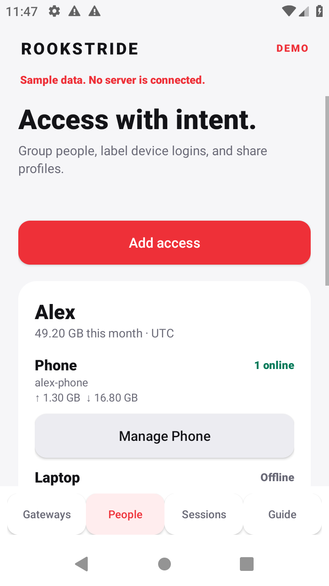
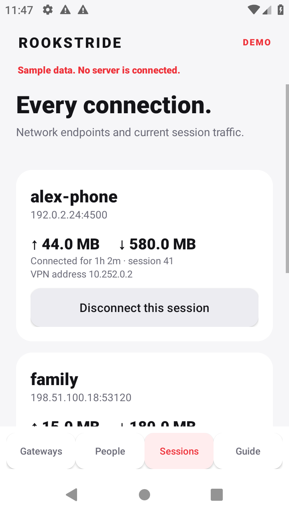
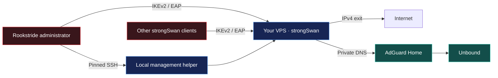

  

<h1 align="center">Rookstride</h1>

  Deploy your VPN. Share access. Keep moving. 
  An independent Android app for your own VPS, powered by strongSwan and AdGuard Home.

  
  
  
  
  
  

  <a href="#quick-start">Quick start</a> ·
  <a href="docs/OPERATIONS.md">App guide</a> ·
  <a href="docs/ARCHITECTURE.md">Architecture</a> ·
  <a href="docs/UNIVERSAL-GATEWAY-RESEARCH.md">Future routes</a> ·
  <a href="#vpn-and-filtering-behavior">Ad blocking</a> ·
  <a href="docs/TESTING.md">Tests</a> ·
  <a href="docs/BUILD.md">Build</a> ·
  <a href="SECURITY.md">Security</a>

An Android app for deploying and managing a personal IKEv2 VPN on your own VPS. The admin can connect in Rookstride; invited users import a profile into the official strongSwan Android app. Country and hosting provider independent.

**Early alpha.** Download the signed APK and complete corresponding source from [Releases](https://github.com/VictorBoykoV/rookstride/releases). See [test status](docs/TESTING.md) before relying on a release. Requires Android 8 or later and a fresh Ubuntu 24.04 VPS for installation. A phone Internet connection and reachable SSH are required; the app bundles its installation code, while the VPS downloads Ubuntu packages and AdGuard Home.

> [!IMPORTANT]
> **Alpha2 passed three consecutive reset → reinstall → real VPN cycles** on Android 8, 9 and 16, including recovery after a VPS reboot. Physical-device, network-handoff and sustained-load checks remain. The [test report](docs/TESTING.md) records the exact scope and the two regression fixes.

## What it does

| Capability | In the app |
|---|---|
| Two servers | Experimental IKEv2 → AWG 3.1 recipe; two fresh Ubuntu nodes, exit-side DNS, staged activation. |
| Deploy | Install strongSwan IKEv2/EAP-MSCHAPv2, AdGuard Home and Unbound over pinned SSH. |
| Connect | Use the embedded strongSwan engine on the administrator's phone. |
| Share | Export password-free `.sswan` profiles for other Android users. |
| Manage access | Organize gateways, people, shared accounts and separate device logins. |
| See connections | Inspect sessions, observed endpoints, VPN addresses and counters; disconnect or revoke access. |
| Track usage | Optionally collect daily and monthly estimates with a small local SQLite service. |
| Filter DNS | Choose Standard, Strong or Strict ad and tracker blocking. |
| Start again | Review and reset a recognized gateway with typed deletion confirmation. |
| Learn offline | Read the built-in guide and licenses; explore the labeled demo. |

No cloud account or public web management API is involved. Root access belongs to the administrator; it is never included in user profiles.

Screenshots show the explicitly labeled, offline demo with fictional data. Meet **Rook**, the original red bird mark used in the app and launcher.

## Quick start

1. Install the APK from a release whose checksum and signing certificate you have verified. Android may ask you to allow installation from your download app.
2. Choose **Add gateway**. Enter the VPS address, SSH port, administrator name and password or private key. Root or passwordless sudo is required.
3. Inspect the gateway. Compare the presented SSH fingerprint with your provider console before trusting it. A changed fingerprint stops the connection.
4. On a fresh Ubuntu 24.04 VPS, choose **Install gateway on fresh VPS**, create the first VPN login, and decide whether to enable usage history.
5. Keep the VPS reachable while installation completes. The job continues on the VPS if the app disconnects; reconnect to check its status.
6. In **People**, select a login and choose **Use on this phone**, then connect from the gateway screen. Or share a user's profile and provide their VPN password separately.

After connecting, verify website access, the exit IPv4, DNS filtering and absence of an unexpected public IPv6 from the actual device over both Wi-Fi and mobile data. See [app operations](docs/OPERATIONS.md).

Use a disposable VPS to try the alpha. An interrupted installation can leave partial configuration; inspect its root-only log before deciding to rebuild. The fresh-install guard deliberately refuses to overwrite an existing VPN or DNS setup.

Existing installations of the bundled [single VPS gateway](https://github.com/VictorBoykoV/single-vps-vpn-gateway) can explicitly enroll the management helper. Arbitrary StrongSwan installations need a migration review; they are not automatically compatible.

## How it works

## VPN and filtering behavior

The Android profile uses MTU 1280, full IPv4 and IPv6 traffic selectors, and blocks traffic outside the VPN while the tunnel is active. This gateway provides IPv4 Internet access and sinks IPv6; AdGuard suppresses AAAA answers. The strongSwan engine exempts Rookstride’s own administration/certificate-fetch traffic so management remains reachable; other applications use the VPN. Android's **Always-on VPN / Block connections without VPN** setting is a separate phone setting for protection while disconnected.

DNS blocking can remove ads and trackers served from separate domains. It cannot reliably remove YouTube in-stream ads, change a datacenter IP's reputation, or stop a site using account, browser or GPS signals. Applications with their own encrypted DNS may bypass DNS filtering. Stronger lists can also break websites; return to Standard or allow a required domain in the private AdGuard dashboard.

Open **Gateways → AdGuard controls** to choose a preset:

| Preset | List | Tradeoff |
|---|---|---|
| Standard | AdGuard DNS filter | Starting point for ordinary ads and trackers. |
| Strong | HaGeZi Pro | Broader blocking; compare website access afterward. |
| Strict | HaGeZi Pro++ | Most aggressive preset; more likely to block a required domain. |

The private dashboard is `http://10.254.0.1:3000` by default, reachable inside the VPN. Its separate login is stored in `/root/single-vps-vpn/adguard-login.txt` on the VPS. See [app operations](docs/OPERATIONS.md) for access, allowlists and recovery.

## People, devices and totals

A shared login can have several simultaneous connections. Separate device credentials give each profile its own login and make revocation and totals clearer. Device labels are administrator supplied; IPsec does not reveal a phone's physical model or router hostname.

Disconnect closes the selected session; a client may automatically reconnect. Revoke removes the login and attempts to close all its sessions, preventing new authentication with that login.

The optional collector samples every 30 seconds and consumes disconnect/rekey events. Totals are UTC calendar-month estimates, excluding IPsec transport overhead. They begin at enrollment, survive collector restarts, and expose monitoring gaps. They are not billing records. See [architecture and resource limits](docs/ARCHITECTURE.md).

## Build, test and contribute

- [App operations and safe reset](docs/OPERATIONS.md)
- [Build the APK and corresponding source](docs/BUILD.md)
- [Testing and release gates](docs/TESTING.md)
- [Architecture](docs/ARCHITECTURE.md)
- [Security and recovery](SECURITY.md)
- [Third-party licenses](NOTICE.md)

The original Android administration code and branding are GPL-3.0-or-later. The embedded strongSwan code retains its upstream GPL-2.0-or-later notices; the combined app is distributed under GPL version 3 or later. Gateway scripts retain their MIT license. No affiliation with strongSwan, AdGuard, OnePlus or Amnezia is implied.

## Two-server gateway · experimental

[**Download 0.2.0-alpha2 APK**](https://github.com/VictorBoykoV/rookstride/releases/download/v0.2.0-alpha2/rookstride-0.2.0-alpha2.apk) · [Complete corresponding source and checksums](https://github.com/VictorBoykoV/rookstride/releases/tag/v0.2.0-alpha2)

The `0.2.0-alpha2` source implements **IKEv2 entry → AmneziaWG 3.1 exit** with independently pinned SSH, detached recoverable jobs, exit-side AdGuard Home and staged activation. Choose **Add a two-server gateway** in the experimental app. Reviewed **Reset both VPN nodes** and **Swap entry and exit** controls allow fresh redeployment from the phone. An optional native SSH relay manages one node through the other while retaining both physical-node identity pins.

Read the [pair guide](docs/PAIR-MODE.md), [real-provider test report](docs/PAIR-PROVIDER-TESTING.md) and [historical local alpha1 tests](docs/PAIR-TESTING.md). The same signed APK configured both real-provider nodes repeatedly, with clean phone resets and reversed roles. Embedded Android and isolated provider-side Linux clients verified IKE/EAP, exit IPv4, filtering and bridge-outage blocking/recovery. The report identifies each client network: one route from the test computer lost UDP replies, while its provider-side client passed. Android 16's coordinator/VPN passed; its emulator's screen navigation remains incomplete because of System UI startup hangs.

The earlier `0.1.0-alpha2` binary is the single-server release. Pair upgrades/importing arbitrary installations and other engines in the [research note](docs/UNIVERSAL-GATEWAY-RESEARCH.md) remain future work. Reset removes owned gateway data and retains Ubuntu, SSH, packages and unrelated files; an OS factory rebuild belongs in the provider's panel.

The local [website source](website/README.md) includes practical documentation, the research proposal, and five original Rook stories with panel/page/chapter views. Website hosting remains a separate step. [Mark revision notes](brand/DESIGN.md) distinguish the new source icon from the already published APK.
