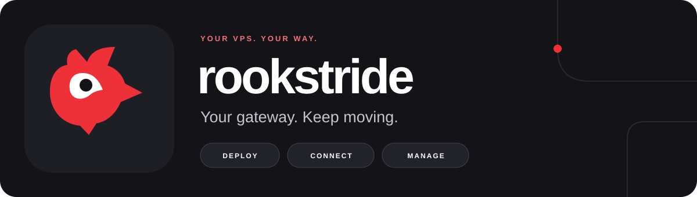
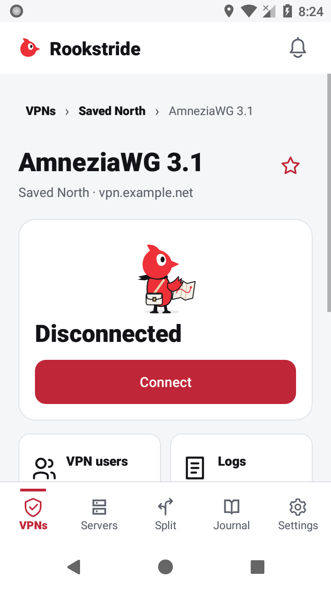
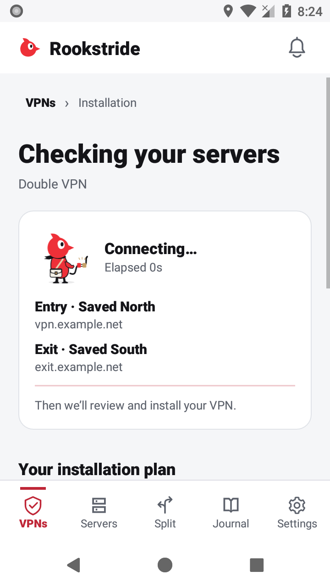
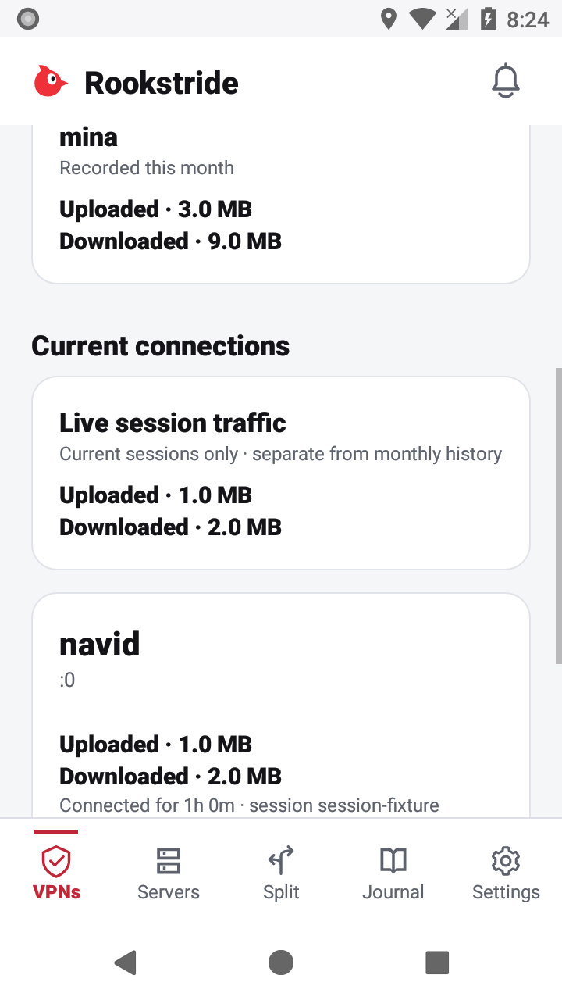
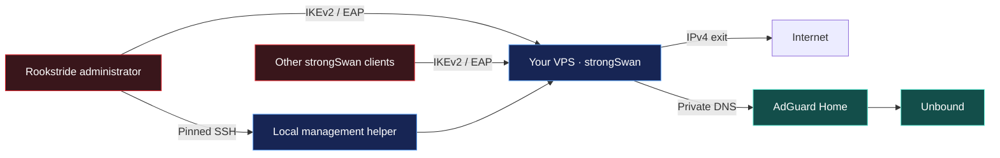

  

<h1 align="center">Rookstride</h1>

  Deploy your VPN. Share access. Keep moving. 
  An open-source VPN manager for Ubuntu servers you rent.

  
  
  
  
  
  
  

  <a href="#quick-start">Quick start</a> ·
  <a href="docs/OPERATIONS.md">App guide</a> ·
  <a href="docs/ARCHITECTURE.md">Android architecture</a> ·
  <a href="docs/WEB-ARCHITECTURE.md">Web app architecture</a> ·
  <a href="#vpn-and-filtering-behavior">Ad blocking</a> ·
  <a href="docs/TESTING.md">Tests</a> ·
  <a href="docs/BUILD.md">Build</a> ·
  <a href="SECURITY.md">Security</a>

Rookstride sets up and manages a VPN on your own Ubuntu VPS. The Android app
includes ten connection methods, account management and experimental Double VPN.
See the [device guide](https://rookstride.com/connect) for supported clients and
profile formats. The [website](https://rookstride.com) also offers a browser demo,
an invitation-only VPN workspace and [assistant setup](https://rookstride.com/agents).

**Android 0.4.0-alpha6** requires Android 8 or later. ARM64 is the recommended
download for most Android phones.

- [Download ARM64 from Rookstride (69.6 MB)](https://rookstride.com/downloads/rookstride-0.4.0-alpha6-arm64.apk)
- [Download the signed ARM64 APK from GitHub](https://github.com/VictorBoykoV/rookstride/releases/download/v0.4.0-alpha6/rookstride-0.4.0-alpha6-arm64.apk)
- [Universal APK for supported 32-bit ARM and x86_64 devices](https://github.com/VictorBoykoV/rookstride/releases/download/v0.4.0-alpha6/rookstride-0.4.0-alpha6-universal.apk)
- [Release notes, checksums and corresponding source](https://github.com/VictorBoykoV/rookstride/releases/tag/v0.4.0-alpha6)

The signed release passed a saved-profile upgrade on Android 8 and live
AmneziaWG Double VPN traffic on an Android 16 emulator. See the
[current release test scope](docs/TESTING.md) and
[Ubuntu compatibility](docs/UBUNTU-COMPATIBILITY.md) for your chosen method.

## Server administration and recovery

The 0.4 prerelease includes a management interface,
reviewed SSH identity replacement, scoped administrator invitations, owner
recovery, coordinated paired rebuilds and AWG pair member replacement. See
[maintenance and recovery](docs/MAINTENANCE-AND-RECOVERY.md) for the exact supported
adapters and retained-data boundaries.

The app can manage servers with a VPN off or with another VPN client
active, subject to that client's Android routing/lockdown rules. Double VPN
checks direct SSH access and can automatically use the reachable node as a
verified relay. Manually chosen VPN passwords use advisory strength warnings;
generated passwords use 15 random characters.

**Wipe server & reinstall Ubuntu** is separate from **Remove VPN setups** and
**Remove server from this phone**. Eligible full virtual machines can replace
their system disk with a reviewed Ubuntu 22.04, 24.04 or 26.04 image. The app verifies
the planned replacement SSH identity and the returned OS before completion.
Unsupported layouts still need provider rebuild tools. Future Ubuntu eligibility
varies by provider and disk layout. See [server management](docs/SERVER-MANAGEMENT.md).

## Reusable sign-in

The app offers address, username and password sign-in for
IKEv2, OpenVPN, Hysteria 2, TrustTunnel and NaïveProxy, including supported
Double VPN entries. New app installations prefer this mode; existing private
profiles keep their explicit migration boundary. See [reusable sign-in](docs/REUSABLE-SIGN-IN.md)
for server trust, IP/domain setup, sharing, reinstall continuity and limitations.

## Connection methods

The app includes AmneziaWG 3.1, IKEv2, OpenVPN and VLESS TCP/REALITY as well as
**VLESS XHTTP/REALITY, Hysteria 2, Outline/WSS, Shadowsocks/v2ray-plugin WSS,
TrustTunnel HTTP/2 and NaïveProxy HTTP/2.** Single-server and Double VPN setup
use the phone's pinned SSH connection. No extra client app is required.

See the [connection comparison](docs/CONNECTION-METHODS.md),
[acceptance report](docs/ADDITIONAL-METHODS-TESTING.md) and
[embedded-engine contract](docs/EMBEDDED-ENGINES.md). Ad blocking, operational
traffic estimates, user management, profile sharing and managed removal apply
to the new methods. Setup normally asks for the server address and administrator
password, with `root` as the default administrator. The current setup and
management interface is in English.

## What it does

| Capability | In the app |
|---|---|
| Two servers | Experimental Double VPN with a separate entry and exit, exit-side DNS and staged activation. |
| Deploy | Install a selected protocol and filtering over pinned SSH. |
| Connect | Use the app's embedded clients on Android. |
| Share | Export a compatible profile or reusable sign-in, depending on the method. |
| Manage access | Organize servers, VPN users, shared accounts and separate device logins. |
| See connections | Inspect sessions, observed endpoints, VPN addresses and counters; disconnect or revoke access. |
| Track usage | Optionally collect daily and monthly estimates with a small local SQLite service. |
| Filter DNS | Choose Standard, Strong or Strict ad and tracker blocking. |
| Start again | Review and reset a recognized gateway with typed deletion confirmation. |
| Follow installation | Recipe-specific checkpoints, elapsed time, remaining steps and coarse planning ranges; browse while the service continues. |
| Split traffic | Choose which Android apps use the VPN for supported client modes. |
| Learn offline | Built-in guide, licenses and native Journal stories. |

The Android app connects directly to your servers. Administrator SSH access
stays separate from the VPN profiles you share.

  
  
  

Screens from the exact signed 0.4.0-alpha6 app on an Android 8 emulator using
example servers and users. [Screenshot provenance and test scope](docs/TESTING.md)

## Quick start

1. Install the APK from a release whose checksum and signing certificate you have verified. Android may ask you to allow installation from your download app.
2. From **VPNs**, choose **Set up a VPN** and pick a single server or Double VPN. Select a connection method and use a saved server or enter your VPS details. Root or passwordless sudo is required.
3. Compare each presented SSH fingerprint with the provider console before approving it. Choose a fresh, eligible VPS for a new installation.
4. Review the installation plan, create the first VPN login and approve setup. Use the progress shortcut to return to the job while browsing the app.
5. Open the saved VPN and tap **Connect**, or open **VPN users** to grant access and export a compatible configuration.

After connecting, verify website access, the exit IPv4, DNS filtering and absence of an unexpected public IPv6 from the actual device over both Wi-Fi and mobile data. See [app operations](docs/OPERATIONS.md).

Use a disposable VPS to try the alpha. An interrupted installation can leave partial configuration; inspect its root-only log before deciding to rebuild. The fresh-install guard deliberately refuses to overwrite an existing VPN or DNS setup.

Existing installations of the bundled [single VPS gateway](https://github.com/VictorBoykoV/single-vps-vpn-gateway) can explicitly enroll the management helper. Arbitrary StrongSwan installations need a migration review; they are not automatically compatible.

## How it works

Single VPN routes traffic through one VPS. Double VPN passes traffic from the
entry VPS to a separate exit VPS. See [How Rookstride works](https://rookstride.com/self-hosted-vpn)
and the [Android architecture](docs/ARCHITECTURE.md). The diagram shows a
single-server IKEv2 example.

## VPN and filtering behavior

The Android profile uses MTU 1280, full IPv4 and IPv6 traffic selectors, and blocks traffic outside the VPN while the tunnel is active. This gateway provides IPv4 Internet access and sinks IPv6; AdGuard suppresses AAAA answers. The strongSwan engine exempts Rookstride’s own administration/certificate-fetch traffic so management remains reachable; other applications use the VPN. Android's **Always-on VPN / Block connections without VPN** setting is a separate phone setting for protection while disconnected.

DNS blocking can remove ads and trackers served from separate domains. It cannot reliably remove YouTube in-stream ads, change a datacenter IP's reputation, or stop a site using account, browser or GPS signals. Applications with their own encrypted DNS may bypass DNS filtering. Stronger lists can also break websites; return to Standard or allow a required domain in the private AdGuard dashboard.

Open a saved VPN and select **Ad blocking** to choose a preset.

| Preset | List | Tradeoff |
|---|---|---|
| Standard | AdGuard DNS filter | Starting point for ordinary ads and trackers. |
| Strong | HaGeZi Pro | Broader blocking; compare website access afterward. |
| Strict | HaGeZi Pro++ | Most aggressive preset; more likely to block a required domain. |

The private dashboard is `http://10.254.0.1:3000` by default, reachable inside the VPN. Its separate login is stored in `/root/single-vps-vpn/adguard-login.txt` on the VPS. See [app operations](docs/OPERATIONS.md) for access, allowlists and recovery.

## People, devices and totals

A shared login can have several simultaneous connections. Separate device credentials give each profile its own login and make revocation and totals clearer. Device labels are administrator supplied; IPsec does not reveal a phone's physical model or router hostname.

Disconnect closes the selected session; a client may automatically reconnect. Revoke removes the login and attempts to close all its sessions, preventing new authentication with that login.

The optional collector samples every 30 seconds and consumes disconnect/rekey events. Totals are UTC calendar-month estimates, excluding IPsec transport overhead. They begin at enrollment, survive collector restarts, and expose monitoring gaps. They are not billing records. See [architecture and resource limits](docs/ARCHITECTURE.md).

## Build, test and contribute

- [App operations and safe reset](docs/OPERATIONS.md)
- [Build the APK and corresponding source](docs/BUILD.md)
- [Testing and release gates](docs/TESTING.md)
- [Android and gateway architecture](docs/ARCHITECTURE.md)
- [Web app and MCP architecture](docs/WEB-ARCHITECTURE.md)
- [Security and recovery](SECURITY.md)
- [Third-party licenses](NOTICE.md)

The original Android administration code and branding are GPL-3.0-or-later. The embedded strongSwan code retains its upstream GPL-2.0-or-later notices; the combined app is distributed under GPL version 3 or later. Gateway scripts retain their MIT license. No affiliation with strongSwan, AdGuard, OnePlus or Amnezia is implied.

## Two-server gateway – experimental

Use the [Android pair guide](docs/PAIR-MODE.md) or the standalone
[two-server Ubuntu scripts](https://github.com/VictorBoykoV/two-hop-vpn-gateway).

Android offers ten methods on each leg. On the signed 0.4.0-alpha6 release,
AmneziaWG on both legs passed certificate-verified HTTPS, filtered DNS and
bridge-outage recovery on two test VPSs. Check the evidence for your chosen
route and use dedicated test servers. [Pair contract and test scope](docs/PAIR-MODE.md)

## Browser workspace and MCP

| Entry point | Available workflow |
|---|---|
| [Browser demo](https://rookstride.com/manage) | Try setup and management with example servers and sample profiles. |
| [Hosted VPN workspace](https://vpn.rookstride.com/vpn) | Invitation-only administration of approved, pinned servers. |
| [Local browser app](web/README.md#start-locally) | Manage your own single server or Double VPN from a loopback workspace. |
| [Agent setup](https://rookstride.com/agents) | Use read-only examples over public MCP or run the local operator connector for real, approved actions. |

[Web app architecture](docs/WEB-ARCHITECTURE.md) explains the processes,
credential handling and the difference between local and hosted support.

## Rook, your guide

Rook is the project’s original ambassador: a small red navigator who steps out of a
book, listens before helping, and leaves room for the next traveler’s choice.
His map, lantern, scarf, and satchel follow him through five connected fictional
worlds. The revised mark keeps a simple, recognizable bird silhouette.

**Five worlds · fifty finished chapters · two hundred story pages.** Lantern Harbor
leads into worlds inspired by Persian gardens, Chinese waterways, Russian winter
stories, and American civic communities. Read one illustrated page or the whole
chapter; optional device narration highlights the scene and turns pages within
that chapter. The next chapter waits for your choice. The original five strip comics
remain available. Culture notes distinguish source inspiration from original fiction.

- [Rook’s origin, character, and ambassador roles](brand/AMBASSADOR.md)
- [The fifty-chapter index and cast](website/WORLDS.md)
- [Artwork and original master sources](website/ARTWORK-WORLDS.md)
- [Historical static website and story generator](website/README.md)
- [Installation progress and offline reading](docs/INSTALLATION-PROGRESS.md)

The mobile coordinator shows each recipe’s checkpoints and broad planning ranges.
Stories and Guide stay available while installation runs in a separate foreground
service. Tap the progress shortcut or notification to return. Force-stop or process
death may end phone polling; detached VPS jobs can continue and require inspection
before resuming. Text, art, and documentation are bundled for offline reading.

[Mark revision notes](brand/DESIGN.md) and [brand rules](brand/AMBASSADOR.md)
cover Rook’s identity across the app, website and artwork.

## Languages and release history

The current Android setup and management interface is in English. The source
retains the earlier English, Russian, Persian, Arabic and Simplified Chinese
translation catalogs. Technical inputs and typed confirmations are unchanged
within a translation.

[Translation workflow](i18n/README.md) · [Localization evidence](docs/LOCALIZATION-TESTING.md)
· [Historical server and UI tests](docs/TESTING.md#historical-010-alpha2-single-server-tests)
