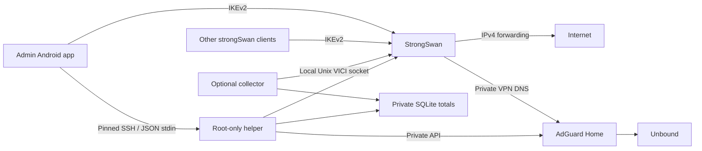

# Architecture

## Phone

Native Java administration screens wrap strongSwan's maintained Android VPN engine. API 26 is the minimum. No hosted control plane, analytics or remote crash-upload service is added. The guide and installer bundle are local assets; installation still needs network access and the VPS downloads packages.

Optional saved credentials are AES-256-GCM encrypted using an Android Keystore key. Without the remember option they remain in app memory and must be entered after a process restart. The SSH fingerprint, labels and server snapshots are also stored in the encrypted vault. VPN profile passwords are excluded from strongSwan's profile database. Shared profiles contain a pinned certificate and login, without a password or administrator secret.

## Deployment

Fresh Ubuntu 24.04 installation and enrollment are distinct explicit actions. SFTP uploads a private bundle; fixed commands invoke the installer with a bounded JSON request on standard input. Installation runs as a detached systemd job with root-only configuration, status and logs. Temporary VPN password/configuration files are deleted when the job finishes. Disconnecting the phone does not cancel the job; rebooting the VPS can interrupt it. Partial installations are not blindly rerun.

The helper runs on demand over SSH. VICI is a local Unix socket, and AdGuard's dashboard/API is private to the VPN. There is no public management service. Changes to users are locked, written atomically and followed by a secrets reload. Failed reloads restore the prior credentials. Revocation also attempts to close all sessions for a shared login and reports any failure.

## Accounting cost and scope

The collector is optional, one Python process using the system's standard library and SQLite. It reads counters; it does not inspect traffic contents. Sampling is every 30 seconds, plus disconnect/rekey events. Separate OS/charon boot IDs and CHILD_SA IDs prevent counter reuse from inflating totals. Monitoring failures and lowered counters are reported as gaps.

The service has **64 MiB MemoryMax and 5% CPUQuota** as protective limits. A 40-second sample on the Ubuntu 24.04 test VPS (one logical CPU, about 1.92 GiB RAM) measured 15,516 KiB collector RSS, 0.025% of one CPU core and 189,120 bytes of SQLite database/WAL files. This short sample included a single test connection and is not a sustained-load benchmark. StrongSwan, AdGuard, Unbound and operating-system updates have their own resource costs. A 1-core/1-GB VPS remains a useful capacity test target; throughput and memory depend on traffic and enabled lists.

Detailed inactive sessions/counters expire after 30 days. Inactive history is also capped at 10,000 rows; daily totals retain 400 days. SQLite checkpoints and incremental vacuum run during daily cleanup. There is no fixed whole-database disk quota; retained daily rows scale with the number of logins. Monitor disk space on small VPSs.

Totals start when monitoring is enabled, use UTC months and represent IPsec payload counters, excluding encryption/network overhead. Polling can miss traffic from sessions that disappear during an outage. Disabling collection retains stored totals. Shared logins aggregate usage; endpoint addresses and administrator labels cannot identify physical hardware.

## Filtering

Standard: AdGuard DNS filter. Strong: HaGeZi Pro. Strict: HaGeZi Pro++. The new list is downloaded/enabled before the previous list is disabled. DNS lists are external data maintained by their authors. Stronger presets can create false positives and do not provide YouTube in-stream ad removal.
