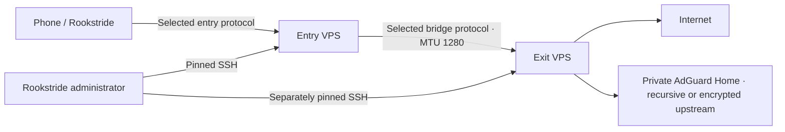

# Two-server VPN – experimental

The Android **0.4.0-alpha6** prerelease offers guided **Double VPN** setup.
You can select any of the ten Android methods for either leg. Live connection
and recovery results apply to the exact paths and builds in the test reports.
The standalone [two-server Ubuntu scripts](https://github.com/VictorBoykoV/two-hop-vpn-gateway)
document their own setup and scope.

| Exit method | First VPS → exit VPS |
| --- | --- |
| AmneziaWG 3.1 | Pinned userspace tunnel |
| IKEv2 | Pinned certificate and Linux IPsec |
| OpenVPN | Certificate-authenticated TCP tunnel |
| VLESS TCP or XHTTP with REALITY | Authenticated Xray TCP/UDP proxy |
| Hysteria 2, Outline, Shadowsocks, TrustTunnel or NaïveProxy | Authenticated transport using the selected method |

The exit protocol is the encrypted connection **between servers**. Your phone
uses only the first protocol inside Rookstride. OpenVPN entry uses a dedicated routed client pool without standalone NAT. Xray
entry binds every client/DNS outbound to an owned source address, with a closed
default outbound and a separate local-socket firewall guard. Xray carries TCP/UDP, not arbitrary IP protocols such
as ICMP. Do not infer regional reachability or performance from a successful lab.

## Requirements

New native setups assess Ubuntu 22.04+ independently on each node; versions may differ. Saved legacy pairs retain their 24.04 requirement. See [Ubuntu compatibility](UBUNTU-COMPATIBILITY.md).

Use two distinct dedicated Ubuntu VPSs with public IPv4, reachable package
repositories and sufficient disk space. A managed reset can prepare previously
owned nodes; an unknown existing VPN is not silently overwritten. One VPS cannot
serve both roles: the app checks machine IDs and reviews both nodes before
installing on either. Provider firewalls must permit the chosen ports:

- New AWG entry: UDP 51820 by default.
- AWG exit: UDP 443 by default.
- IKEv2 entry or exit: UDP 500 and 4500; the original entry also supports a selected
  redirected NAT-T port.
- OpenVPN entry or exit: TCP 1194 by default.
- Xray entry or exit: TCP 443 by default.
- SSH: normally TCP 22. Alternative ports and management relays are optional.

The original IKEv2 → AWG recipe needs the pinned kernel module and compatible
headers. Native AWG legs use the pinned userspace implementation in
owned containers, including the AWG bridge; a leftover host kernel module does
not select their implementation. The phone needs an Internet connection.

## Install from Android

1. Choose **Set up a VPN → Double VPN**. Follow the five steps: phone protocol,
   exit protocol, first-server access, exit access, and review. Back keeps your
   entries; rotation retains the draft in memory.
2. Choose each VPS from **Choose a saved server**, or supply its address and
   administrator password (root by default). Saved nodes retain their SSH pin and
   encrypted access; there is no need to delete and add them again.
   Optional administrator names, ports, keys and relay settings are in Advanced. Saving administrator
   access is visible and selected by default; it is encrypted on this phone.
3. If selected nodes already contain recognised Rookstride VPNs, review the
   removal scope and acknowledge the affected accounts before proceeding. The
   app closes an old entry before its old exit even when swapping roles.
   Check each SSH fingerprint against the provider console. A changed key stops
   authentication. The app verifies both nodes before installation.
4. Progress includes explicit exit ad-blocking and available entry-monitoring
   checks. The app prepares the exit and private DNS, guards the entry, configures the
   bridge, checks the expected exit IPv4 and allowed/blocked DNS, then opens
   forwarding. You can read Stories while the foreground installation continues.
5. Connect inside Rookstride. Optional exports use native AmneziaWG `.conf`,
   IKEv2 `.sswan`, OpenVPN `.ovpn` or a VLESS URI. These contain VPN access, never root credentials.
6. Test the actual phone on Wi-Fi and mobile data. Server or emulator success
   cannot prove a particular mobile network permits the selected transport.

AWG bridge client material and the IKEv2 pinned certificate/bridge credentials
travel through the two verified encrypted SSH connections. They are stored in
root-owned files. Do not publish manifests, exported profiles or install logs.

## Filtering, users and statistics

Ad blocking is on the **exit**, so the complete route uses exit DNS. Settings in
Rookstride target that exit through its own verified SSH session. Users and
connection estimates belong to the entry. Standalone native protocols on one VPS
share one native filtering service; IKEv2 retains its separate existing filter.
An imported entry record alone cannot manage an absent exit record.

Fresh native exit filtering queries encrypted Quad9 and Cloudflare DNS in
parallel, with a bounded upstream timeout. Both resolvers receive queries; existing
operator preferences are not replaced. This avoids waiting for an unreachable
primary before trying the other encrypted resolver. IKEv2 exits use the existing Unbound recursive
resolver. Startup retries an enabled empty blocklist without changing selected
lists or disabling protection; a failed DNS check still stops setup.

Statistics refresh on opening and every five minutes while that screen is visible.
They are operational estimates, not provider billing or reliable device identities.
DNS filtering does not remove every ad or control an application's encrypted DNS.

## Interrupted installation and routing protection

Root-owned manifests and detached systemd jobs survive app navigation and SSH
loss. Reopen the saved pair and resume. Its plan, installer identity and bridge
material must match; another installer version is refused instead of silently
replacing a running pair. The first activation timestamp stops elapsed time at
completion, including a later resume.

Native entries use a dedicated source-routing table, a permanent blackhole
fallback and forwarding guards. The main host default route and SSH stay separate.
AWG → IKEv2 uses a dedicated XFRM interface and pinned exit certificate. Entry
client traffic is rejected at entry-local services. IPv6 Internet forwarding is
blocked. Neither a stopped bridge nor a missing IPsec SA should fall back to the
entry's Internet uplink. Owned startup units restore policy before the entry VPN.
See [strongSwan's route-based VPN design](https://docs.strongswan.org/docs/latest/features/routeBasedVpn.html).

## Abandon an unfinished setup

A failed or interrupted setup offers **Check and resume** and **Abandon setup**.
Abandon removes its progress notice on this phone. It preserves server records
and remote job IDs; it does not stop a detached job or remove software. Inspect
and review server cleanup separately. An actively running phone coordinator
cannot be dismissed by an old abandon confirmation.

## Direct VPNs alongside Double VPN

The new route needs both nodes free of previous VPN setups. The wizard can
review and remove recognised software on your selected saved nodes first. It does not
support separate direct-entry, direct-exit and two-hop connections concurrently
on the same two VPSs. That needs independent address pools and routing policies;
installing over existing standalone NAT could create an unwanted direct exit.
Use **Change Double VPN protocols** to reuse both nodes with new choices. This
reviews replacement, removes the old setup and redeploys; it is not an in-place
protocol switch and previous VPN accounts/keys are replaced. Standalone mode
still supports adding more protocols later without an extra server-creation step.

## Reuse a server

**Remove this server's VPN setup** can recover either locally recognised pair
node without the old phone pair record or a reachable partner. Review and confirm
the listed owned components. It removes that node's VPN/bridge/accounts/keys and
owned filtering; the other node remains unchanged and its old route stops working.
The cleaned node can host a single-server VPN or either two-server role.

**Reset both VPN nodes** reviews both machines and removes the entry before the
exit. It is coordinated, not atomic; an interrupted reset can be reviewed again.
Home shows both physical nodes with Entry/Exit badges. After full removal, the
phone retains two separate reusable server records with
their original SSH pins/access. Changed ownership, altered service units,
unexpected links and active jobs stop cleanup for review. File paths are optional
technical details, not part of a server’s displayed name. Protocol choices and
non-secret reviews allow Android screenshots; administrator/secret dialogs remain
protected.

This removes recognised Rookstride configuration and data. Ubuntu, SSH, installed
package binaries, unrelated files and independently saved recovery archives remain.
It does not reinstall Ubuntu. **Wipe server & reinstall Ubuntu** is a separate
reviewed action for eligible full VMs; erasing either node breaks the Double VPN
and does not erase its partner. Unsupported layouts need provider rebuild tools.
Root SSH access does not grant a hosting-provider account API. See
[server management](SERVER-MANAGEMENT.md).

## Sources and evidence

The original MIT backend is pinned under [twohop](../twohop/SOURCE.json); its
[standalone repository](https://github.com/VictorBoykoV/two-hop-vpn-gateway) retains
the CLI workflow. New coordinators/adapters are part of Rookstride's GPL source.
Native dependency identities are in [engine pins](../android/engines/pins.json).
[AmneziaWG documentation](https://docs.amnezia.org/documentation/amnezia-wg/)
describes the upstream protocol; Rookstride is an independent app.

Historical [provider tests](PAIR-PROVIDER-TESTING.md) and
[local pair tests](PAIR-TESTING.md) apply only to their named builds. Candidate
acceptance must record exact source/bundle/APK hashes, both-node installation,
real client egress/DNS, outage/recovery and role reversal. Never equate a successful
build or SSH installation with physical-phone reachability or regional availability.
