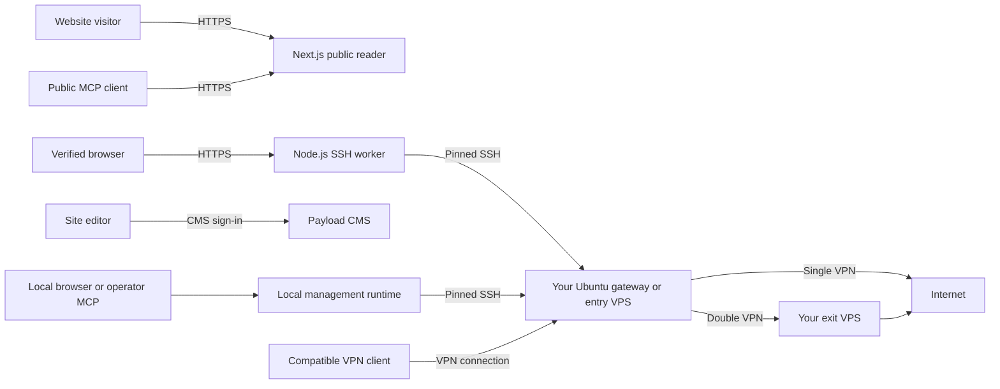

# Web app architecture

Rookstride has a public website, a browser VPN workspace and a local operator
connector. The workspace is open to everyone. You verify your browser and sign
in to Ubuntu servers you control. Your VPN client connects to those servers to
carry its traffic. [Public VPN workspace](https://web.rookstride.com/) · [How Rookstride works](https://rookstride.com/how-it-works)

## What runs where

| Component | What it does |
| --- | --- |
| [Public website](https://rookstride.com/) | A Next.js and React reader serves guides, Journal, Comics, APK downloads, the browser demo and public MCP examples. |
| Private editorial CMS | Payload stores editor accounts, drafts and media. The database and uploads belong to the CMS. The public reader serves approved content using its own data directory. [Website and CMS deployment](../web/deploy/README.md) |
| [Browser workspace](https://web.rookstride.com/) | A Next.js interface offers Single VPN, Double VPN and reopening an existing VPN. ALTCHA verifies the browser. The workspace displays queue and job progress and lets the operator download compatible profiles. |
| Hosted SSH worker | A separate Node.js process uses `ssh2`, bounded sessions and target reservations. It validates the requested operation, checks the SSH host key, and runs reviewed gateway recipes on the chosen VPS. [Worker source](../web/scripts/hosted-pilot.mjs) |
| [Local browser](../web/README.md#start-locally) | The loopback workspace uses the workstation’s SSH connection for operations supported by the local runtime. |
| [Local operator MCP](../web/README.md#operate-one-real-vps-with-a-local-assistant) | Runs over stdio on the operator’s computer. Uses a private target file and a separate terminal approval for installation, management changes, sensitive downloads and recovery. |
| [Public MCP](https://rookstride.com/mcp) | Serves read-only examples over Streamable HTTP. [Assistant setup](https://rookstride.com/agents) |
| Ubuntu gateways | Run the VPN service, own its user list and apply DNS filtering where supported. The browser exports a profile for a compatible device client. |

## How setup reaches your server

1. Open the workspace, choose a setup, and enter your VPS address and sign-in.
   The browser reviews the discovered SSH host key or uses a fingerprint you
   provide. The SSH connection checks the approved key before authentication.
2. Review the chosen protocol and operation. The worker binds the operation
   to the browser session and reserves the target while doing the work.
3. The reviewed recipe runs on the VPS. Double VPN verifies exit routing and
   DNS before forwarding traffic from the entry. Download the profile and
   connect using a compatible VPN client.

The browser and local operator connector offer ten standalone methods. Double
VPN checks the selected entry and exit methods against the two inspected
servers. Protocol support, profile format, repair and recovery vary by method
and host. [Connection methods](CONNECTION-METHODS.md) · [Maintenance and recovery](MAINTENANCE-AND-RECOVERY.md)

Cloudflare proxies the public site and browser workspace over HTTPS. The
workspace and its credential-bearing requests use cache bypass. The app,
SSH worker and user VPS enforce browser admission, SSH authentication and
gateway permissions. On supported gateways, AdGuard Home filters DNS on
the single server or the Double VPN exit. [Security](../SECURITY.md)

[Run the web app locally](../web/README.md#start-locally) · [Android and gateway architecture](ARCHITECTURE.md) · [Release tests](TESTING.md)
