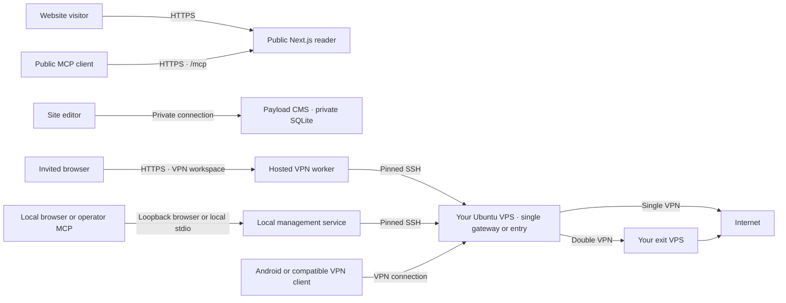

# Web app architecture

Rookstride uses Next.js for the website and browser app, Payload CMS for
editing, and separate Node.js processes for VPN administration. The VPN
servers carry a connected device’s traffic. The website serves the setup
interface, guides and Android downloads.

## What runs where

| Component | Responsibility |
|---|---|
| [Public reader](https://rookstride.com) | Serves published pages, the demo, APK downloads and the public MCP examples. [The reader policy](../web/src/lib/web-runtime.mjs) allows the public routes and assets. |
| Private CMS | Stores editor accounts, drafts and uploads in a separate SQLite database and media directory. The reader has its own publication state. [Publishing and deployment](../web/deploy/README.md) |
| [Hosted VPN workspace](https://vpn.rookstride.com/vpn) | Uses an invitation bound to approved servers and SSH fingerprints. A separate [hosted worker](../web/scripts/hosted-pilot.mjs) handles the VPN API and reserves the enrolled targets for the session. |
| [Local browser app](../web/README.md#start-locally) | Runs on loopback. Its [gateway endpoint](../web/src/app/api/gateway/route.ts) runs the account and installation workflow using the reviewed recipes in this checkout. |
| [Local operator MCP](../web/README.md#operate-one-real-vps-with-a-local-assistant) | Runs on the operator’s computer over stdio. It reads a private target file and requires separate terminal approval for installation, account changes, sensitive downloads and recovery. |
| Ubuntu gateways | Hold the VPN service, accounts and filtering configuration. The browser exports a profile for a compatible VPN client. |

The public [MCP endpoint](https://rookstride.com/mcp) offers example inspection
and capability tools. The [browser demo](https://rookstride.com/manage) uses
example server data and simulates setup, account changes and downloads.

## Setup and trust

1. Inspect the server with an independently verified SSH fingerprint. The
   SSH connection checks that pin before sending authentication.
2. Review the exact target, method and operation. The worker binds approval
   to the active session and reserves the target against another installation.
   It sends typed requests and the reviewed recipe over SSH.
3. Check the installed gateway and export a compatible client profile. Double
   VPN verifies routing and DNS at the exit before activating forwarding from
   the entry. A separate client can then verify HTTPS, exit address and DNS.

SSH passwords and exported profiles stay within the authorized operation.
The CMS stores editorial data. The operator keeps server records, recovery
archives and private configuration files separately. See
[security](../SECURITY.md) and [maintenance and recovery](MAINTENANCE-AND-RECOVERY.md).

## Current availability

The workstation browser and local MCP offer ten standalone methods and ten
choices for each Double VPN role. The local live trial used both interfaces
and an independent Linux client across fifteen routes – nine additional entry
methods with an AmneziaWG exit and six additional exits with an AmneziaWG
entry. Route-specific outage and rebuild qualification is separate.

The hosted pilot currently admits one preapproved pair. It offers AmneziaWG
at the entry and AmneziaWG, OpenVPN certificate mode, IKEv2 or VLESS
TCP/REALITY at the exit. The paired rebuild control is disabled in that
deployment. The source supports separate enrollment and recovery
configurations for isolated trials.

[Run the web app locally](../web/README.md) ·
[Android and gateway architecture](ARCHITECTURE.md) · [Release tests](TESTING.md)
