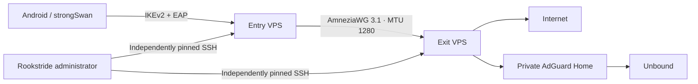

# Two-server gateway · experimental

The `0.2.0-alpha2` source includes one complete recipe in the Android app:

The public `0.1.0-alpha2` APK is the earlier single-server release. The `0.2.0` pair builds are experimental. Read the [real-provider test report](pair-provider-testing.md); [PAIR-TESTING.md](pair-testing.md) records the historical alpha1 local-machine tests. WireGuard, OpenVPN and Xray client engines remain proposals.

## Requirements

- Two distinct, fresh Ubuntu 24.04 machines, x86_64 or arm64, with public IPv4 and Internet access.
- Independent SSH addresses, ports and root credentials or private keys. Passwordless sudo is also supported.
- Provider firewall access for entry UDP 500/4500 and exit UDP 443 by default. A custom client or bridge port can be selected before installation.
- A matching kernel and headers able to build/load the pinned AmneziaWG module. When a kernel change is required, the app offers an owned reboot and then resume.
- Reachable Ubuntu repositories, the signed AWG package repository and the checksum-pinned AdGuard Home release. The phone needs an Internet connection. If one SSH endpoint is unreachable directly, **Advanced → Manage entry through exit** or **Manage exit through entry** can use the other node as a management relay. Both host keys are independently checked before authenticating to their respective nodes. The relay must permit SSH TCP forwarding and reach the target's SSH port; it is not a VPN transport workaround.

One physical VPS cannot serve as both roles. The app checks machine IDs before changing either node, refusing aliases of the same machine. Two isolated local VMs can test the coordinator and real tunnel, but a production two-hop route needs two VPSs. Shared-host tests do not certify routing between independent providers.

## Install from Android

1. Add a **two-server gateway**. Enter separate entry and exit SSH details. Check each presented fingerprint against its provider console; a changed key stops the operation before authentication.
2. Set the public entry VPN address and exit tunnel endpoint. These may differ from their management SSH addresses. Create the initial VPN login with the generated strong password or another password of at least 16 characters.
3. Install. The app first prepares the exit, then the entry under a forwarding guard. Private tunnel keys are generated on each node and never leave it. Shared tunnel authentication material is transferred only through the two verified SSH sessions.
4. The coordinator configures exit DNS, configures IKEv2 and the bridge, checks a recent handshake, staged exit IPv4 and a real DNS answer, then activates client forwarding. It stops at a failed check.
5. Use **People → Use on this phone**, or export a password-free `.sswan` profile for the official strongSwan Android app. Share the VPN password separately.
6. Test the actual phone on Wi-Fi and mobile data: HTTPS, visible exit IPv4, DNS filtering and IPv6 behavior. A successful SSH install cannot establish that the phone’s network permits IKEv2.

AdGuard settings are sent to the exit; accounts, sessions and estimated user traffic are managed at the entry. The dashboard listens on the private exit tunnel address. The embedded client remains IKEv2; this mode does not add an AmneziaWG phone client.

## Interrupted installation and pause

Each node stores a root-owned pair manifest and detached systemd jobs. Closing the app or losing SSH does not kill the server job. Reopen the saved pair and choose **Install / resume / verify pair**. The saved plan, peer material and installer digest must match. The app does not silently switch an existing pair to new installer code.

Root-only job state/logs live under `/var/lib/rookstride-pair/JOB/`; ownership and material under `/etc/rookstride-pair/`. Never publish those files. A changed partial IKE configuration or changed owned tunnel configuration stops recovery.

**Pause client forwarding** raises a persistent guard. It does not restore a direct entry route. Resume repeats staged verification before activation. A bridge outage retains a blackhole route for VPN client addresses. Reboots restore the recorded active or paused state before IKE clients can use the gateway.

## Current boundaries

- Fresh pair installation, recovery of its owned jobs, reviewed pair data reset and role swapping after reset are supported. Pair upgrades and importing an arbitrary existing pair are not supported. Use a provider rebuild for a whole operating-system wipe.
- Only one pair per dedicated node. No nested chains, selectable phone engines or mixed protocol recipes.
- IPv4 Internet routing; IPv6 client Internet traffic is rejected. Always-on Android lockdown is a separate phone setting. The admin app’s management traffic is exempt from its embedded VPN.
- DNS filtering cannot reliably remove YouTube in-video ads; apps with their own encrypted DNS may bypass domain filtering.
- Usage is an estimate at the entry, not provider billing. Both VPS providers and the exit’s address reputation still matter.

## Reset and reverse the route from Android

1. Select the saved pair and choose **Reset both VPN nodes**. The app reviews both nodes' ownership and lists the managed files and services.
2. Type **DELETE PAIR**. The entry VPN stops before its forwarding protection is removed; the exit's tunnel and DNS data are removed afterward. Ubuntu, SSH, installed package binaries and unrelated files are retained. A separately saved root-only recovery archive is outside this reset scope.
3. The app removes its saved VPN profile and marks the nodes fresh. Choose **Swap entry and exit**, check the VPN address and tunnel endpoint, and install again. Physical-node credentials and SSH pins stay attached to their original servers; the new route gets a new pair identity and new VPN certificates/tunnel keys.

Both nodes must be reachable for review. Reset is coordinated across two machines, not an atomic transaction. If interrupted after one node is cleaned, choose Reset again: the already-fresh node is a reviewed no-op, and the remaining owned node is cleaned. Changed ownership/configuration, extra tunnels, unexpected links or an active installation stop the reset. A running installation should finish or be resumed first.

If the client never receives an IKE response, inspect both client and server logs before changing credentials. An SSH management relay cannot repair this path. The optional entry UDP 443 port redirects to strongSwan's NAT-T listener; the exported profile must use that same selected port. Availability depends on the actual client's network and provider firewall. See [strongSwan's custom-port/NAT-T requirements](https://docs.strongswan.org/docs/latest/features/natTraversal.html). Custom-port evidence here covers strongSwan Android/Linux clients; standard-port native clients need their own compatibility checks.

## Source and dependencies

The MIT backend is vendored under [twohop](https://github.com/VictorBoykoV/rookstride/blob/main/twohop/SOURCE.json) with the original repository/commit and exact file hashes. The new SSH coordinator and server job adapter are part of Rookstride’s GPL source. The original [Two-Hop VPN Gateway repository](https://github.com/VictorBoykoV/beget-vpn-gateway) retains its CLI workflow.

Ubuntu 24.04 pair builds pin `amneziawg-tools=1.0.20210914-0~202608130144+ee0f0a9~ubuntu24.04.1` and `amneziawg-dkms=1.0.0-0~202609061402+4569c4c~ubuntu24.04.1`. The loaded parser/module must retain 3.1 parameters and complete a real handshake. Availability of these package versions and support for a provider kernel remain deployment prerequisites. AdGuard Home 0.107.79 archives are SHA-256 verified before extraction.
